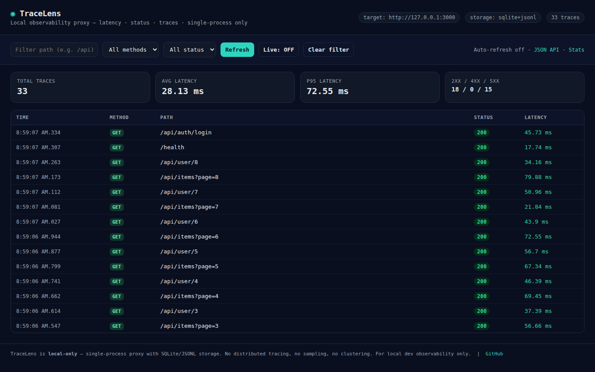

# TraceLens

Proxy observability lokal yang sekaligus menginspeksi keamanan secara pasif. Ia merekam latency, status, dan header HTTP, lalu menyimpan hasilnya ke SQLite/JSONL. Satu proses, jalan lokal saja.

## Scope

TraceLens adalah proxy developer untuk monitoring API satu mesin dan inspeksi keamanan trafik secara pasif. Ia merekam trace tiap request, mengukur latency, dan menandai masalah keamanan seperti cookie tanpa enkripsi, header keamanan yang hilang, atau API token yang bocor di URL.



## Yang Dilakukan

- Memproksi target HTTP apa pun (`TARGET=http://localhost:3000`) di `http://localhost:3888`
- Merekam per request: method, path, status, latency (ms), timestamp, target, headers, error
- Passive Security Inspector: mendeteksi header CSP/MIME yang hilang, cookie tidak aman, dan kredensial di query params
- Menyimpan ke `data/traces.jsonl` (selalu) dan `data/traces.db` via `node:sqlite` bila tersedia (Node >=22.5)
- Menyediakan viewer minimal dan JSON API di `/__tracelens`

## Mulai Cepat

```bash
npm install
TARGET=http://localhost:3000 npm start
# atau
PORT=3888 TARGET=http://localhost:3000 node src/proxy.mjs
```

Kirim trafik lewat proxy:

```bash
curl http://localhost:3888/api/hello
```

Buka viewer dan hasil pemeriksaan keamanan:
- Viewer: http://localhost:3888/__tracelens
- Laporan keamanan: http://localhost:3888/__tracelens/security

## API Endpoints

| Endpoint | Keterangan |
|---|---|
| `GET /__tracelens` | Viewer HTML |
| `GET /__tracelens/traces` | Daftar traces JSON |
| `GET /__tracelens/security` | Temuan keamanan trafik pasif |
| `GET /__tracelens/stats` | Jumlah request, latency avg/p95, jumlah temuan keamanan |
| `GET /__tracelens/health` | Health check |

## Lisensi

[MIT License](LICENSE)

